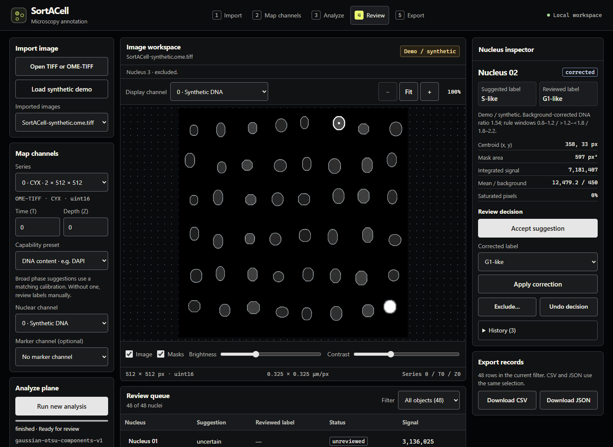

# SortACell

SortACell is a local microscopy annotation workspace for turning TIFF and OME-TIFF fields into a table of reviewed nuclei. It segments a selected 2D plane, measures raw fluorescence, and lets you accept, correct, or exclude individual objects while inspecting the corresponding masks. Each export ties the results to the source image, channel and plane selection, and analysis run.



## What you can do

- Import a self-contained TIFF or OME-TIFF and inspect series, axes, channel names, dtype, and pixel size when available.
- Map a nuclear channel such as DAPI and choose the DNA-content, marker, or manual review preset. Marker review uses a separate display and measurement channel and supports manual positive and negative labels.
- Inspect a 2D preview with zoom, pan, mask outlines, and display-only brightness and contrast. Select objects in the image or the keyboard-accessible review queue.
- Accept a suggestion, apply a correction, exclude with a reason, or undo a decision. Each action keeps the original suggestion and adds to the history.
- Reopen a run or named session and export the active filter to CSV and JSON. A new run gets new object IDs and preserves the earlier review.

## Run locally

Install **Python 3.12**, **Node.js 24**, and **pnpm 11.25.0**. If pnpm is missing and npm is available, run `npm install --global pnpm@11.25.0`. Run the commands from the extracted `SortACell` directory.

**Windows PowerShell**

```powershell
py -3.12 -m venv .venv
.\.venv\Scripts\python.exe -m pip install -r requirements-lock.txt
Push-Location frontend
pnpm install --frozen-lockfile
pnpm build
Pop-Location
.\.venv\Scripts\python.exe -m uvicorn backend.main:app --host 127.0.0.1 --port 8000
```

**macOS or Linux**

```bash
python3.12 -m venv .venv
.venv/bin/python -m pip install -r requirements-lock.txt
(cd frontend && pnpm install --frozen-lockfile && pnpm build)
.venv/bin/python -m uvicorn backend.main:app --host 127.0.0.1 --port 8000
```

Open [SortACell on this computer](http://127.0.0.1:8000). Choose **Load synthetic demo**, map **Synthetic DNA** as the nuclear channel, and select **Analyze nuclei**. Select a nucleus, apply a review decision, filter the queue, then try saving and reopening the view. [Getting started](wiki/Getting-Started.md)

The application and its data stay on this computer. By default, the workspace lives in `.sortacell/`. It stores TIFF copies, label masks, and a SQLite database. Set `SORTACELL_DATA_DIR` before starting the service to choose a separate folder. Backup and export details are in the wiki. [Sessions and exports](wiki/Sessions-and-Exports.md)

## Scientific scope

SortACell v0.1.0 is a research annotation prototype. Segmentation uses Gaussian smoothing, Otsu thresholding, and connected components. Touching nuclei may merge. DNA-content labels are **unvalidated suggestions** for broad G1-like, S-like, and G2/M-like groups. DNA amount alone cannot distinguish G0 from G1 or G2 from M. Imported fields stay uncertain without explicitly confirmed calibration for that exact source and mapping. The generated demo teaches the workflow and supports software testing. [Methods and limitations](wiki/Methods-and-Limitations.md) · [Microscopy method reference](https://pmc.ncbi.nlm.nih.gov/articles/PMC6318798/)

The current importer processes one selected 2D plane from a self-contained grayscale TIFF series. For OMERO data, export an OME-TIFF in OMERO and open that file here. Direct OMERO server access, large tiled images, 3D analysis, and independent performance evaluation remain future work. [Supported images](wiki/Getting-Started.md#supported-images) · [OMERO export documentation](https://www.openmicroscopy.org/omero/features/export/)

## Verification and documentation

The local checks exercise TIFF import and mapping, source integrity, synthetic suggestions, review history, cancellation, failure recovery, saved sessions, and matching exports. Browser and accessibility results are recorded separately from scientific evaluation. [Verification results](docs/validation/FINAL.md) · [Wiki home](wiki/Home.md) · [Development and API](wiki/Development.md)

## About the developer

I’m a biotechnology graduate student at the University of South Florida (USF). I built SortACell to make microscopy annotation less repetitive while keeping the evidence behind each label visible.
